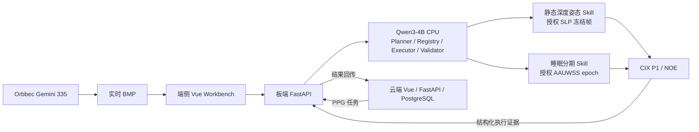

# CIX P1 端云协同健康监测 Agent

项目将 Qwen3-4B 的任务规划与 CIX P1 的专用模型推理解耦。Qwen 在板端 CPU 上选择 Skill，Executor 按注册表校验参数和数据授权，再调用 NOE。验证器将模型输出、输入哈希和执行证据绑定到同一次 ToolResult，工作台和云端据此展示结果。

| 演示 | 输入 | 输出 |
| --- | --- | --- |
| `depth_posture_analysis` | 已登记 SLP 静态深度帧，默认样本 `s101_p08` | 仰卧、左侧卧或右侧卧，以及 CIX 执行证据 |
| `sleep_stage_inference` | 已登记 AAUWSS `12/1`，30 秒 PPG 窗口 | 睡眠分期、模型和输入 SHA-256、CIX 执行证据 |
| Orbbec 实时预览 | Gemini 335 连续采集 | 经板端 FastAPI 读取的实时 BMP |

## 最小启动

1. **CIX P1 板端**使用 Orange Pi 6 Plus ARM64、兼容的驱动与 NOE Python 环境。准备已校验 GGUF、两个 CIX 模型及授权样本，按需安装 Orbbec ARM64 SDK。模型、样本和 SDK 单独取得。[资产与 SHA-256](docs/demo-assets.md)
2. **板端采集与 API**按部署说明启动相机用户服务，再运行 `bash edge-platform/deploy/start-demo.sh`。脚本启动本地 llama-server 和 FastAPI，默认分别监听板端回环 `18080` 和 `18551`。[命令与变量](docs/demo-reproduction.md)
3. **普通 PC**用 Node 22 运行端侧 Vue，通过 SSH 将本机 `8001` 转发到板端 API。云端 FastAPI、PostgreSQL 16 和 Vue 可由普通 PC 的 Docker Compose 启动。云端提交任务前需登记板端设备并接通领单与回传。[前端和云端部署](docs/demo-reproduction.md)

## 演示与实机证据

在端侧页面先查看 Gemini 335 预览，再在 Workbench 请求已登记的 `s101_p08`。历史板端记录返回 `supine`，worker 打开 `/dev/aipu` 并记录 NOE 同步推理。然后从云 Vue 为登记设备提交 AAUWSS `12/1`。历史实机记录显示板端 NOE 返回 `N1`，PostgreSQL 保存一条结果事件，Vue 回读成功。没有板卡的评委可以直接审查模型与输入哈希、原始输出、任务关联和源记录哈希。[脱敏实机证据](docs/hardware-evidence.md)

## 已知边界

- 实时相机预览与静态 SLP 推理独立运行。实时 Y16 帧尚未接入姿态 Skill，姿态推理按请求使用独立 worker。
- 云睡眠分期使用授权 PPG 样例，当前演示未把新采集的 PPG 映射到分期输入。证据中样例标注是 Wake，模型输出是 N1。记录用于展示执行、对照和追溯能力，不能作为临床准确性或总体性能结论。
- 实机证据来自历史验收版本。本次候选复用已校验模型和执行源码，最终候选的整套板端部署未在本轮重跑。

工程入口为 `edge-platform/`、`cloud-platform/` 和 `shared/`。后端与共享契约回归保留在各平台及 `tests/`。
