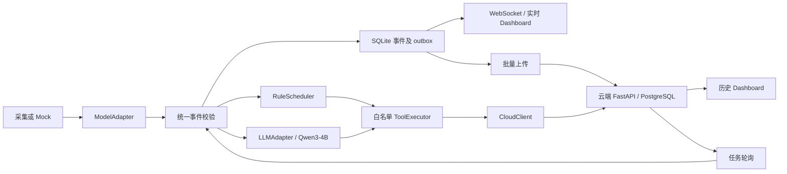

# 架构与责任

采用两个独立可部署应用和一个共享契约目录，不引入消息中间件或复杂微服务。

端侧模块：采集适配、模型适配、事件入口、规则、Agent、工具执行、本地存储、同步、REST/WS。一个 FastAPI 应用即可；推理耗时任务不得阻塞事件循环，后续采用有界队列及工作线程/进程，具体实现待性能验证。

模型部署由用户独立管理。本仓库当前不加载模型、不下载权重、不访问 NPU、摄像头、麦克风或串口。已验证的 YOLOv8s-Pose 约 26 FPS 与 Qwen3-4B-Q4_K_M CPU 推理属于外部能力；不承诺新系统吞吐量。

模型适配统一 ModelInput/ModelOutput。data 与 metadata 保留模态特定输入，必须由实现验证 modality；输出为统一 Event。不可用、输入错误与运行失败有显式状态，不伪造预测。PhysiologicalAdapter、VisionAdapter、AudioAdapter、LLMAdapter 均为 Protocol。

RuleScheduler 对相同输入和规则版本产生确定性工具调用。LLM 只提出决策；ToolExecutor 按工具白名单、参数 Schema、超时和 call_id 去重执行，不执行任意 Shell 或模型生成代码。CloudClient 创建/轮询分析任务。调度阈值与医疗含义需要用户确认，当前不硬编码。

云端单 FastAPI + PostgreSQL 保存不可变事件、设备注册及任务状态。任务先以同应用的受控后台执行器实现，后续有容量需求再拆分队列。Docker Compose 由 B 后续编写。

SQLite 与 PostgreSQL 统一 UUID、UTC 和 JSON 语义；事件时间与服务接收时间分别存储。事件唯一键为 event_id，授权额外约束 device_id。避免保存视频/音频原始内容；当前协议仅携带推理结果。

Windows 开发先 Mock；共享层不包含平台专用二进制。Linux ARM64 在构建时选择对应依赖与镜像，不把 Windows wheel/venv 打包上线。真实模型进程的资源隔离与 CIX 运行库由后续集成确定。
